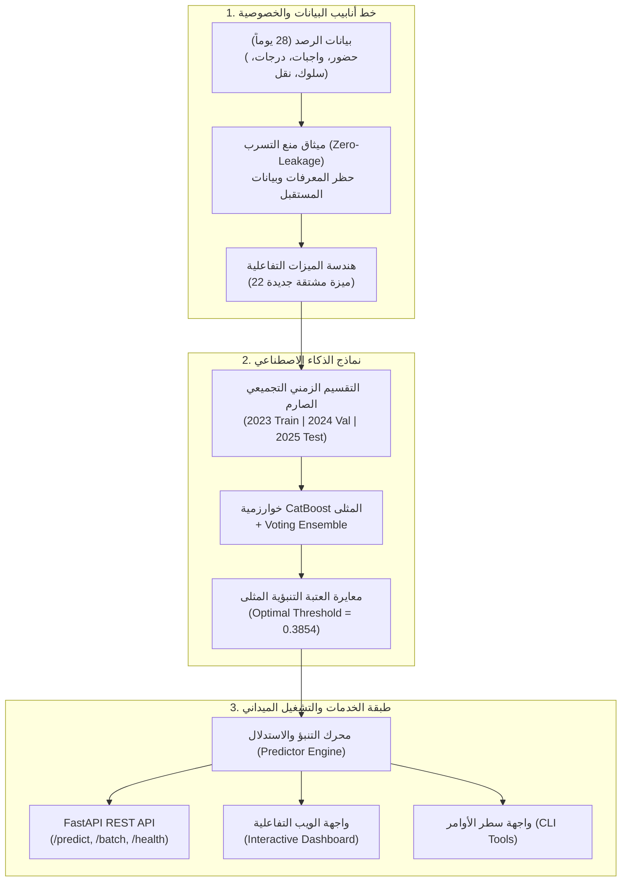

# منصة إشراف — نظام الإنذار المبكر لمخاطر حضور وتسرب الطلاب
# Ishraf Student Attendance Risk & Drop-out Early Warning System

[](https://www.python.org/downloads/)
[](https://fastapi.tiangolo.com)
[](https://catboost.ai)
[](https://www.docker.com/)
[](LICENSE)
[](.github/workflows/ci.yml)

> **مشروع التخرج النهائي لمسار تعلم الآلة (End-to-End Machine Learning Capstone Project)**  
> حل متكامل من الألف إلى الياء (A to Z) يجمع بين البحث الإحصائي، هندسة الميزات الموجهة بالمجال، التدريب المقارن لأقوى نماذج الـ Gradient Boosting، واجهة برمجة تطبيقات REST API، لوحة تحكم تفاعلية للمدارس، وأدوات CLI وحاويات Docker جاهزة للنشر الفوري.

---

## 🌟 نظرة عامة (Overview)

يشكل الغياب المتكرر والتسرب الطلابي أحد أكبر التحديات التي تواجه المؤسسات التعليمية. يهدف هذا النظام إلى تزويد المشرفين التربويين والأخصائيين الاجتماعيين بنظام إنذار مبكر ذكي قادر على:
1. **التنبؤ الاستباقي:** تقدير احتمالية هبوط نسبة حضور الطالب إلى ما دون 85% (`label_at_risk_next_14d = 1`) خلال **الـ 14 يوماً القادمة**.
2. **الاستناد إلى سجلات 28 يوماً:** تحليل تفاعلات الحضور، أداء الواجبات، نتائج الاختبارات، السلوكيات الميدانية، واستخدام النقل المدرسي.
3. **التفسير المحلي وتحديد الأسباب (Explainability):** استخراج العوامل المحددة التي أدت لتصنيف الطالب كمعرض للخطر لكل حالة على حدة.
4. **توجيه التدخل الإنساني (Prescriptive Intervention):** تقديم توصيات عملية موجهة للأخصائي وولي الأمر لإنقاذ الطالب قبل فوات الأوان.

---

## 🏗️ البنية الهندسية للنظام (System Architecture)



---

## 📊 مصفوفة نتائج التقييم النهائي (Benchmark Performance)

تم تقييم النماذج على **مجموعة اختبار مستقبلية مستقلة خارج العينة (Test Set - دفعة 2025: 99,990 طالباً)** تحت شروط عزل زمني وتجميعي صارم:

| النموذج (Model) | ROC-AUC | PR-AUC | Precision | Recall (الحساسية) | F1-Score | Brier Score (المعايرة) |
| :--- | :---: | :---: | :---: | :---: | :---: | :---: |
| **CatBoost Classifier (الفائز)** | **0.9200** | **0.8752** | 75.38% | **84.62%** | 0.7974 | **0.1092** |
| **Weighted Voting Ensemble** | 0.91997 | 0.8750 | 75.62% | 84.43% | **0.7978** | 0.1092 |
| **XGBoost Classifier** | 0.9197 | 0.8744 | 75.37% | 84.60% | 0.7972 | 0.1094 |
| **Logistic Regression** | 0.9193 | 0.8740 | 75.93% | 84.36% | 0.7987 | 0.1095 |
| **LightGBM Classifier** | 0.9193 | 0.8739 | 75.67% | 84.39% | 0.7975 | 0.1096 |
| **HistGradientBoosting** | 0.9192 | 0.8738 | 75.72% | 84.21% | 0.7975 | 0.1097 |

### تدقيق العدالة وتكافؤ الحساسية (Subgroup Fairness Parity):
أثبت فحص النموذج عبر كافة المراحل الدراسية (الصفوف من 1 إلى 7) استقرار حساسية الكشف (Recall) بين **83.2% و 85.9%**، مما يضمن معاملة عادلة وحماية متكافئة لجميع الفئات العمرية.

---

## 🚀 التشغيل السريع (Quickstart)

### 1. التشغيل المحلي (Local Setup)

```bash
# 1. استنساخ المشروع وتثبيت البيئة
git clone <repo-url>
cd ishraf_ml_coursework
python -m venv .venv
source .venv/bin/activate  # في ويندوز: .venv\Scripts\activate

# 2. تثبيت الحزم المطلوبة
pip install -r requirements.txt

# 3. تشغيل السيرفر وواجهة الويب التفاعلية
python app/server.py
```
افتح المتصفح على الرابط: `http://localhost:8000`

---

### 2. التشغيل عبر Docker (Containerized Deployment)

```bash
# بناء وتشغيل الحاوية بأمر واحد
docker-compose up --build
```
* **واجهة الويب:** `http://localhost:8000`
* **توثيق Swagger التفاعلي:** `http://localhost:8000/docs`

---

### 3. استخدام أداة سطر الأوامر (CLI Usage)

يوفر المشروع أداة CLI قوية للمهندسين والمشرفين:

```bash
# فحص صحة النظام والنموذج المحمّل
python cli.py health

# التنبؤ لطالب فردي عبر ملف JSON مع استخراج أسباب الخطر
python cli.py predict -i data/sample_student.json

# معالجة ملف CSV جماعي للطلاب واستخراج النتائج
python cli.py predict-batch -i data/sample_new_students.csv -o evaluated_students.csv

# استعراض مصفوفة مقاييس الاختبار المعتمدة
python cli.py metrics
```

---

## 📡 واجهة برمجة التطبيقات (API Reference)

### 1. فحص طالب فردي (`POST /predict`)
**الطلب (Request):**
```json
{
  "student_key": "STUDENT_001",
  "grade_level_id": 4,
  "lookback_attendance_records": 20,
  "lookback_present_count": 13,
  "lookback_absent_count": 6,
  "lookback_late_count": 1,
  "lookback_attendance_percent": 65.0,
  "lookback_assessment_count": 2,
  "lookback_assessment_average_percent": 55.0,
  "lookback_homework_due_count": 5,
  "lookback_homework_completed_count": 1,
  "lookback_homework_missing_count": 4,
  "transport_assigned_at_snapshot": true,
  "lookback_transport_boarded_count": 6,
  "lookback_transport_absent_count": 5
}
```

**الاستجابة (Response):**
```json
{
  "student_key": "STUDENT_001",
  "grade_level_id": 4,
  "is_at_risk": true,
  "risk_probability": 0.9452,
  "risk_level": "CRITICAL",
  "decision_threshold": 0.3854,
  "primary_risk_factors": [
    "نسبة الحضور السابقة متدنية (65.0%) مع تسجيل 6 غيابات",
    "تدني ملحوظ في متوسط الدرجات والتقييمات (55.0%)",
    "تراكم 4 واجبات مدرسية مفقودة لم تُسلّم",
    "تكرار التخلف عن ركوب الحافلة المدرسية (5 مرات)"
  ],
  "recommended_interventions": [
    "التواصل العاجل مع ولي الأمر واستيضاح مبررات الغياب المتكرر",
    "إحالة الطالب لبرنامج التقوية الأكاديمية والمتابعة الصفية المباشرة",
    "جلسة إرشاد مع المعلم المعني لتنظيم جدول الواجبات والمتابعة اليومية",
    "التنسيق مع مشرف النقل المدرسي لمراجعة توقيت وموقع محطة الحافلة"
  ]
}
```

### 2. فحص دفعة عبر ملف CSV (`POST /predict/csv`)
ارفع أي ملف CSV وسيُعاد تنزيل نفس الملف مضافاً إليه:
* `predicted_probability`: الاحتمالية الرقمية الدقيقة.
* `is_at_risk`: القيمة المنطقية (True/False).
* `risk_level`: مستوى الخطر (`LOW`, `MODERATE`, `HIGH`, `CRITICAL`).

---

## 🧪 الاختبارات الآلية وضمان الجودة (Testing & QA)

يحتوي المشروع على حزمة اختبارات شاملة تغطي:
1. اختبارات هندسة الميزات ومنع التسرب الزمني (`test_feature_engineering.py`).
2. اختبارات محرك الاستدلال وتصنيف مستويات الخطر (`test_inference.py`).
3. اختبارات تكامل واجهات الـ API (`test_api.py`).
4. اختبارات وحدة خوارزميات التوليد والتشفير بـ Vitest.

```bash
# تشغيل كامل اختبارات بايثون
pytest tests/ -v

# تشغيل اختبارات TypeScript / Vitest
pnpm test
```

---

## 🛡️ ميثاق الأخلاقيات وحوكمة الذكاء الاصطناعي (AI Ethics)

1. **مبدأ الإنسان في الحلقة (Human-in-the-Loop):** تنبيهات النموذج استرشادية ولا يُتخذ أي قرار آلي بحق أي طالب.
2. **الحظر القاطع للعقوبات:** يُمنع تماماً استخدام التنبؤ لتوقيع أي عقوبة أو حرمان من الأنشطة.
3. **الخصوصية التامة:** تم استبعاد الأسماء، العناوين، وإحداثيات السكن، واستبدال المعرفات بـ HMAC مشفر.

---

## 📁 هيكلية المستودع (Repository Structure)

```
ishraf_ml_coursework/
├── .github/workflows/ci.yml       # أتمتة الاختبارات والبناء السحابي (CI/CD)
├── app/
│   ├── api.py                     # مسارات وتطبيقات FastAPI
│   ├── schemas.py                 # نماذج التحقق Pydantic
│   ├── server.py                  # خادم التشغيل
│   └── static/                    # واجهة الويب التفاعلية (HTML/CSS/JS)
├── src/
│   ├── core/                      # الإعدادات والاستثناءات
│   ├── data/                      # هندسة الميزات ومنع التسرب
│   └── models/                    # محرك الاستدلال والتفسير
├── ml/
│   ├── artifacts/training-runs/   # النموذج المدرب والمقاييس المعتمدة
│   ├── notebooks/                 # دفاتر Jupyter المكتملة بمخرجاتها
│   └── scripts/                   # سكريبت التدريب الآلي
├── data/                          # عينات تجريبية جاهزة للاختبار (JSON & CSV)
├── tests/                         # حزمة الاختبارات الآلية
├── cli.py                         # واجهة سطر الأوامر الميدانية
├── Dockerfile                     # ملف بناء الحاوية الإنتاجية
├── docker-compose.yml             # إعدادات تشغيل الخدمات
├── Makefile                       # أوامر الاختصار للمطورين
└── requirements.txt               # الحزم والتبعيات البرمجية
```

---

## 👨‍💻 مطور المشروع (Author & Developer)

<div align="center">

### **أيمن الذهبي | Ayman Al Thahbi**
**IT Graduate | Software Developer | AI-Assisted Software Engineering**  
*جامعة ذمار — كلية الحاسبات وتكنولوجيا المعلومات | متدرب في برنامج إعداد مهندسي الذكاء الاصطناعي (AI Engineer Training Program)*

[](https://github.com/AymnAlthahby)
[](mailto:ayman.alzhabi.dev@gmail.com)
[](tel:+967774998429)
[](https://maps.google.com)

</div>

| الخاصية | القيمة |
| :--- | :--- |
| **الاسم** | أيمن الذهبي (Ayman Al Thahbi) |
| **التخصص** | تقنية المعلومات (Information Technology) |
| **الجامعة والتأهيل** | جامعة ذمار (كلية الحاسبات وتكنولوجيا المعلومات) — **متدرب في برنامج إعداد مهندسي الذكاء الاصطناعي** |
| **التركيز المهني** | تطوير البرمجيات، هندسة تعلم الآلة والأنظمة الذكية (Software Engineering & Machine Learning Systems) |
| **GitHub** | [github.com/AymnAlthahby](https://github.com/AymnAlthahby) |
| **البريد** | [ayman.alzhabi.dev@gmail.com](mailto:ayman.alzhabi.dev@gmail.com) |
| **الهاتف** | `+967 774 998 429` |
| **الموقع** | اليمن (Yemen) |

---

## 📄 الترخيص (License)
هذا المشروع مرخص بموجب رخصة [MIT License](LICENSE).
