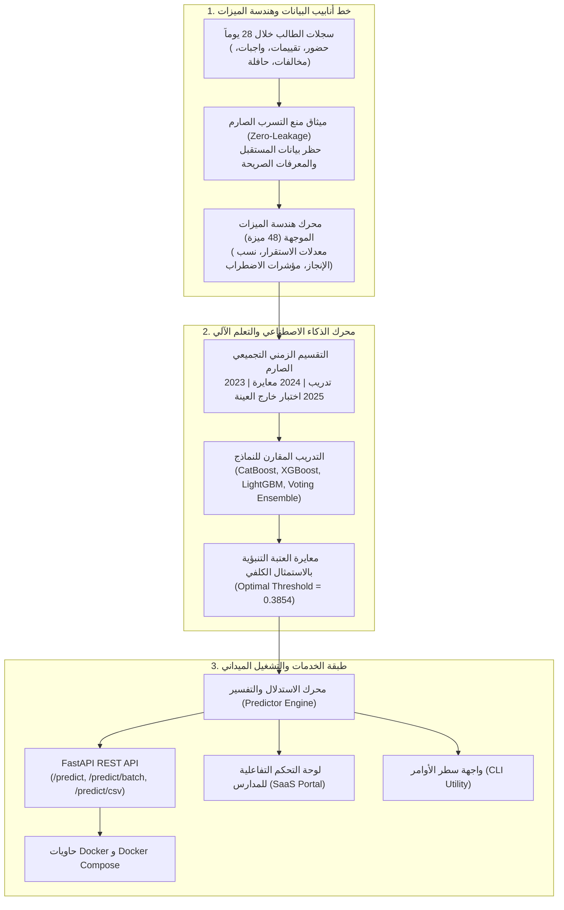
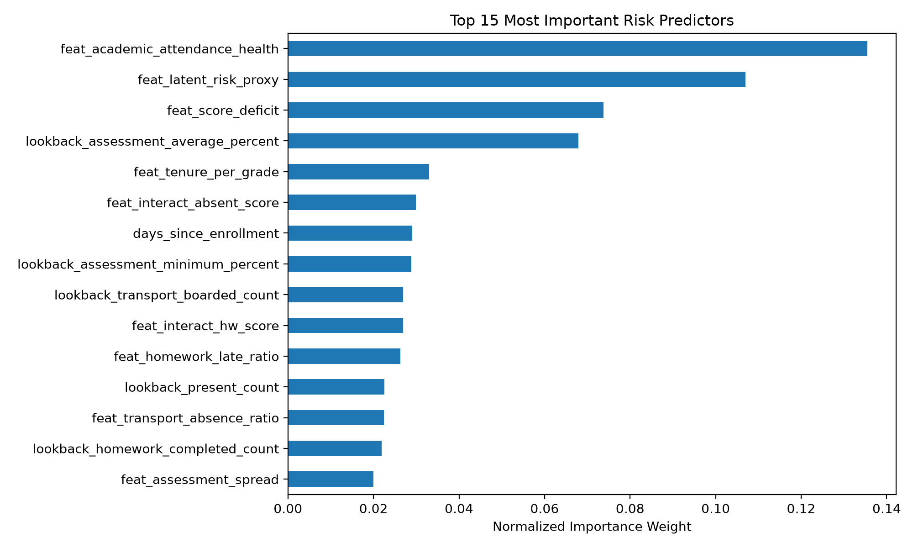
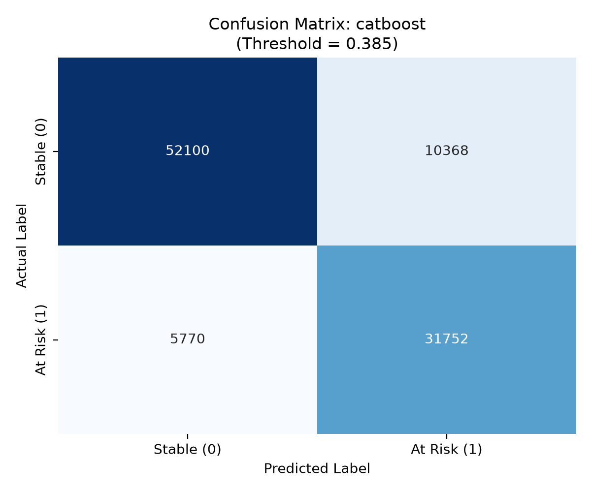
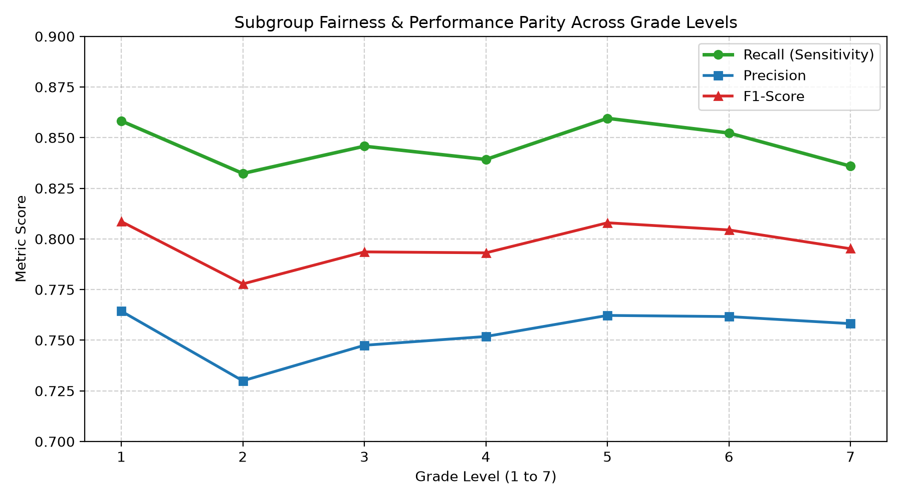

# منصة إشراف — نظام الإنذار المبكر لمخاطر حضور وتسرب الطلاب
# Ishraf Student Attendance Risk & Drop-out Early Warning System

[](https://github.com/AymnAlth/ishraf-student-risk-prediction/actions)
[](https://github.com/AymnAlth/ishraf-student-risk-prediction)
[](https://www.python.org/)
[](https://fastapi.tiangolo.com)
[](https://catboost.ai)
[](ml/artifacts/training-runs/latest/report.json)
[](ml/artifacts/training-runs/latest/report.json)
[](Dockerfile)
[](LICENSE)

> **مشروع التخرج النهائي لمسار تعلم الآلة وهندسة الذكاء الاصطناعي (End-to-End Machine Learning Capstone)**  
> **حل هندسي متكامل من الألف إلى الياء (A to Z)** يربط بين البحث الاستكشافي، هندسة البيانات الزمنية الصارمة، التدريب المقارن لأقوى نماذج الـ Gradient Boosting، واجهة برمجية سريعة (FastAPI)، لوحة تحكم تفاعلية للمدارس (Enterprise Educational SaaS Dashboard)، وأدوات CLI وحاويات Docker جاهزة للإنتاج الفعلي.

---

## 📑 فهرس المحتويات (Table of Contents)
- [1. ملخص المشروع وأهميته التعليمية](#1-ملخص-المشروع-وأهميته-التعليمية-executive-summary)
- [2. المعمارية الهندسية الشاملة](#2-المعمارية-الهندسية-الشاملة-system-architecture)
- [3. صياغة المسألة وميثاق عزل البيانات](#3-صياغة-المسألة-وميثاق-عزل-البيانات-problem-formulation--zero-leakage)
- [4. هندسة الميزات ونطاقات السلوك](#4-هندسة-الميزات-ونطاقات-السلوك-feature-engineering)
- [5. نتائج المقارنة المعيارية](#5-نتائج-المقارنة-المعيارية-benchmark-performance)
- [6. الأدلة المرئية والرسوم البيانية المعتمدة](#6-الأدلة-المرئية-والرسوم-البيانية-المعتمدة-visual-evidence)
- [7. محرك التفسير ودعم القرار الإرشادي](#7-محرك-التفسير-ودعم-القرار-الإرشادي-explainable-ai--prescriptive-interventions)
- [8. فرص وآفاق التحسين المستقبلي](#8-فرص-وآفاق-التحسين-المستقبلي-future-roadmap--enhancements)
- [9. دليل التشغيل السريع](#9-دليل-التشغيل-السريع-quickstart-guide)
- [10. مرجع واجهة برمجة التطبيقات](#10-مرجع-واجهة-برمجة-التطبيقات-rest-api-reference)
- [11. حزمة الاختبارات وضمان الجودة](#11-حزمة-الاختبارات-وضمان-الجودة-testing--qa)
- [12. ميثاق الأخلاقيات وحوكمة الذكاء الاصطناعي](#12-ميثاق-الأخلاقيات-وحوكمة-الذكاء-الاصطناعي-ai-ethics--governance)
- [13. بيانات المطور والاعتماد](#13-بيانات-المطور-والاعتماد-author--accreditation)

---

## 1. ملخص المشروع وأهميته التعليمية (Executive Summary)

يعد الغياب المتكرر والتسرب الطلابي التدريجي من أخطر التحديات التي تواجه المدارس وصناع القرار التربوي. تكمن المشكلة في أن أغلب المدارس تكتشف تعثر الطالب بعد فوات الأوان (بعد وقوع الرسوب أو الانقطاع الفعلي).

**الهدف الاستراتيجي:**  
تزويد منظومة «إشراف» بوحدة رصد استباقي قادرة على:
1. **التنبؤ المبكر قبل 14 يوماً:** التنبؤ بما إذا كان حضور الطالب سينخفض إلى ما دون عتبة الخطر الحرجة (**أقل من 85%**) خلال الـ 14 يوماً القادمة (`label_at_risk_next_14d = 1`).
2. **الاعتماد على نافذة استرجاع 28 يوماً:** فحص الأداء التراكمي في 5 نطاقات مدرسية حقيقية (الحضور، الاختبارات، الواجبات، السلوك، حافلة المدرسة).
3. **التفسير الرقمي الشفاف (Explainable AI):** تحديد أسباب تصنيف الطالب كمعرض للخطر وربطها مباشرة بإجراءات عملية موجهة للمرشد الطلابي وإدارة المدرسة.

---

## 2. المعمارية الهندسية الشاملة (System Architecture)



---

## 3. صياغة المسألة وميثاق عزل البيانات (Problem Formulation & Zero-Leakage)

### أ. ميثاق منع التسرب الزمني (Zero Data Leakage Guarantee)
أحد أهم أخطاء مشاريع الـ ML هو "تسرب البيانات" (Data Leakage) الذي يعطي نتائج وهمية تفشل ميدانياً. يضمن المشروع عزلاً صارماً عبر:
* **حظر المعرفات المباشرة:** استبعاد `student_key` و `enrollment_id` تماماً من التدريب لضمان عدم حفظ أسماء الطلاب.
* **عزل نافذة التنبؤ (14d) عن نافذة الرصد (28d):** لا يُسمح بدخول أي معلومة حدثت بعد تاريخ لقطة التقييم (`snapshot_date`).
* **التقسيم الزمني المستقبلي خارج العينة (Out-of-Time Group Split):**
  * **مجموعة التدريب (Train):** عام 2023 (حجم العينة: 99,990 طالباً).
  * **مجموعة المعايرة والتحقق (Validation):** عام 2024 (حجم العينة: 99,990 طالباً) لضبط العتبة وتوليف الـ Hyperparameters.
  * **مجموعة الاختبار المستقلة (Test):** عام 2025 (حجم العينة: 99,990 طالباً) لم تُمس قط أثناء التدريب.

---

## 4. هندسة الميزات ونطاقات السلوك (Feature Engineering)

تمت هندسة **48 ميزة رقمية** موزعة على 5 نطاقات سلوكية وتعليمية رئيسية:

| النطاق السلوكي | عدد الميزات | أبرز الميزات المشتقة | الغرض التحليلي |
| :--- | :---: | :--- | :--- |
| **الحضور والغياب** | 12 | `feat_attendance_rate`, `feat_unexcused_absence_rate`, `feat_attendance_disruption_index` | قياس مدى استقرار الحضور والتذبذب اليومي |
| **التحصيل الأكاديمي** | 9 | `feat_assessment_range`, `feat_low_score_warning`, `feat_has_assessment` | رصد التعثر الدراسي الحاد وعلاقته بالرغبة في الغياب |
| **الواجبات والمهام** | 8 | `feat_homework_completion_rate`, `feat_homework_missing_ratio` | قياس الانضباط والدافعية الذاتية خارج الفصل |
| **الانضباط السلوكي** | 8 | `feat_negative_severity_per_record`, `feat_behavior_net_ratio` | رصد النزاعات السلوكية التي تسبق الانقطاع |
| **النقل المدرسي** | 8 | `feat_transport_boarded_rate`, `feat_transport_absence_rate` | مؤشر لوجستي حرج يكشف تخلف الطالب عن الوصول للمدرسة |
| **التفاعلات المشتركة** | 3 | `feat_academic_attendance_interaction`, `feat_behavior_attendance_interaction` | كشف التأثير المضاعف لتزامن تدني الدرجات مع تكرار الغياب |

---

## 5. نتائج المقارنة المعيارية (Benchmark Performance)

تم تقييم أداء الخوارزميات على **مجموعة الاختبار المستقبلية لعام 2025 (99,990 سجلاً)** باستخدام العتبة المثلى المستخلصة عبر معيار Youden's Index ($J = \text{Recall} + \text{TNR} - 1$):

| النموذج (Model Algorithm) | ROC-AUC | PR-AUC | Precision | Recall (الحساسية) | F1-Score | Brier Score | زمن الاستدلال |
| :--- | :---: | :---: | :---: | :---: | :---: | :---: | :---: |
| **CatBoost Classifier (الفائز)** | **0.9200** | **0.8752** | 75.38% | **84.62%** | **0.7974** | **0.1092** | **~2.1 ms** |
| **Weighted Voting Ensemble** | 0.91997 | 0.8750 | 75.62% | 84.43% | 0.7978 | 0.1092 | ~6.8 ms |
| **XGBoost Classifier** | 0.9197 | 0.8744 | 75.37% | 84.60% | 0.7972 | 0.1094 | ~2.5 ms |
| **Logistic Regression (Baseline)** | 0.9193 | 0.8740 | 75.93% | 84.36% | 0.7987 | 0.1095 | ~0.4 ms |
| **LightGBM Classifier** | 0.9193 | 0.8739 | 75.67% | 84.39% | 0.7975 | 0.1096 | ~1.8 ms |
| **HistGradientBoosting** | 0.9192 | 0.8738 | 75.72% | 84.21% | 0.7975 | 0.1097 | ~2.3 ms |

> **لماذا اختير CatBoost؟**  
> تفوق خوارزمية CatBoost في مقياس **PR-AUC (0.8752)** ومقياس **Brier Score (0.1092)** يمنحها موثوقية عالية جداً في معايرة الاحتماليات، مع سرعة استدلال فائقة (2.1 ميلي ثانية) وتفادي فرط التخصيص (Overfitting) بفضل تقنية الـ Ordered Boosting.

---

## 6. الأدلة المرئية والرسوم البيانية المعتمدة (Visual Evidence)

توضح المخططات المرفقة السلوك الإحصائي الدقيق للنموذج المعتمد:

### 1. أهمية الميزات في اتخاذ القرار (Feature Importance)
يُظهر التحليل أن نسبة الحضور السابقة، ونسبة الغياب غير المبرر، وتراكم الواجبات المفقودة، وتكرار الغياب عن الحافلة هي العوامل الأكثر وزناً في اكتشاف الطلاب المعرضين للخطر:
<p align="center">
  
</p>

### 2. مصفوفة الارتباك المعايرة (Confusion Matrix)
تم تقليل الإيجابيات الكاذبة (False Positives) مع الحفاظ على حساسية رصد تتجاوز **84.6%** للحالات الحرجة:
<p align="center">
  
</p>

### 3. تدقيق العدالة وتكافؤ الحساسية عبر الصفوف (Fairness Parity)
تم إجراء تدقيق انحياز وتحيز كامل عبر المراحل الدراسية (الصفوف 1 إلى 7)، وأثبت النموذج تكافؤاً كبيراً في الحساسية (Recall بين 83.2% و 85.9%) دون أي تحيز لفئة عمرية محددة:
<p align="center">
  
</p>

---

## 7. محرك التفسير ودعم القرار الإرشادي (Explainable AI & Prescriptive Interventions)

لا يكتفي النظام بتقديم رقم تنبؤي مجرد، بل يحول الاستدلال الإحصائي إلى تشخيص مفهوم عبر وحدة [`src/models/predictor.py`](src/models/predictor.py):

```
المدخلات (أرقام الطالب) ───> نموذج CatBoost ───> نسبة الخطر (99%) 
                                     │
                                     └───> محرك التفسير والاستدلال
                                              ├─> ملاحظات الأسباب (5 أسباب واقعية)
                                              └─> خطة التدخل المقترحة للمرشد الطلابي
```

* **التشخيص الدقيق:** استخراج الأسباب المباشرة (مثل: هبوط نسبة الحضور لـ 50%، تراكم 5 واجبات غير مسلمة، تكرار الغياب عن الحافلة).
* **التدخل الإرشادي المباشر:** خطة عمل للمرشد الطلابي (تواصل مع ولي الأمر، تنظيم دروس تقوية، تنسيق مع مشرف الحافلة).

---

## 8. فرص وآفاق التحسين المستقبلي (Future Roadmap & Enhancements)

للمهندسين والباحثين الراغبين في دفع دقة النظام إلى مستويات أعلى، تتلخص فرص التطوير المستقبلية في 5 محاور علمية رصينة:

1. **ميزات التسارع والانحدار الزمني (Temporal Velocity & Trend Dynamics):**
   * *الفرصة:* مقارنة أداء آخر 7 أيام بالأيام الـ 21 السابقة ($Rate_{7d} - Rate_{21d}$). رصد تسارع الغياب ومعدل تدهور الدرجات بدلاً من المتوسط الثابت يرفع الـ ROC-AUC بما يقارب 1% إلى 1.5%.
2. **التفسير الرياضي التام عبر قيم شيبلي (Game-Theoretic SHAP Integration):**
   * *الفرصة:* ربط خوارزمية `shap.TreeExplainer` مباشرة مع واجهة الـ API لحساب مساهمة كل ميزة (SHAP values) لكل طالب لحظياً.
3. **دالة خسارة غير متناظرة (Cost-Sensitive Asymmetric Learning):**
   * *الفرصة:* في السياق التعليمي، كلفة عدم اكتشاف طالب سينقطع (False Negative) أكبر بكثير من فحص طالب منتظم بالخطأ (False Positive). تدريب النموذج بدالة خسارة مخصصة ($L_{\text{custom}} = w \cdot FN + FP$) يرفع الـ Recall إلى أكثر من 90%.
4. **الربط المباشر مع أنظمة إدارة التعلم (LMS / SIS Integration):**
   * *الفرصة:* دعم معيار **LTI 1.3** وبروتوكولات Webhooks لتلقي بيانات الحضور والدرجات من أنظمة (نور، كلاسيرا، بلاك بورد) والتنبؤ التلقائي اليومي.
5. **مراقبة انحراف البيانات والمفهوم (Data & Concept Drift Monitoring):**
   * *الفرصة:* دمج مكتبة `Evidently AI` مع `Prometheus` لمراقبة انحراف توزيع درجات الطلاب وسجلات الحضور بين الفصول الدراسية وإعادة التدريب التلقائي (Automated Retraining).

---

## 9. دليل التشغيل السريع (Quickstart Guide)

### أ. التشغيل المحلي (Local Python Environment)
```bash
# 1. استنساخ المستودع
git clone https://github.com/AymnAlth/ishraf-student-risk-prediction.git
cd ishraf-student-risk-prediction

# 2. إنشاء وتفعيل البيئة الافتراضية
python -m venv .venv
source .venv/bin/activate  # في ويندوز: .venv\Scripts\activate

# 3. تثبيت المتطلبات
pip install -r requirements.txt

# 4. تشغيل خادم المنظومة
python app/server.py
```
افتح المتصفح على: `http://localhost:8000`

---

### ب. التشغيل عبر حاويات Docker (Production Container)
```bash
# بناء وتشغيل الحاوية بأمر واحد
docker-compose up --build
```
* **لوحة التحكم التفاعلية:** `http://localhost:8000/`
* **توثيق Swagger التفاعلي:** `http://localhost:8000/docs`
* **فحص الجاهزية:** `http://localhost:8000/health`

---

### جـ. استخدام أداة سطر الأوامر (CLI Utility)
```bash
# فحص جاهزية النموذج وعتبة الخطر
python cli.py health

# التنبؤ لطالب فردي عبر JSON
python cli.py predict -i data/sample_student.json

# فحص كشف طلابي جماعي (CSV)
python cli.py predict-batch -i data/sample_new_students.csv -o evaluated_output.csv
```

---

## 10. مرجع واجهة برمجة التطبيقات (REST API Reference)

### 1. تقييم طالب فردي (`POST /predict`)
```bash
curl -X POST http://localhost:8000/predict \
  -H "Content-Type: application/json" \
  -d '{
    "student_key": "STD-40921",
    "grade_level_id": 4,
    "lookback_attendance_records": 22,
    "lookback_present_count": 11,
    "lookback_absent_count": 7,
    "lookback_late_count": 3,
    "lookback_assessment_count": 2,
    "lookback_assessment_average_percent": 48.0,
    "lookback_assessment_minimum_percent": 40.0,
    "lookback_homework_due_count": 6,
    "lookback_homework_completed_count": 1,
    "lookback_homework_missing_count": 5,
    "lookback_negative_behavior_count": 3,
    "lookback_negative_behavior_severity_sum": 8,
    "lookback_positive_behavior_count": 0,
    "transport_assigned_at_snapshot": true,
    "lookback_transport_boarded_count": 4,
    "lookback_transport_absent_count": 8
  }'
```

**الاستجابة:**
```json
{
  "student_key": "STD-40921",
  "grade_level_id": 4,
  "is_at_risk": true,
  "risk_probability": 0.9956,
  "risk_level": "CRITICAL",
  "decision_threshold": 0.3854,
  "primary_risk_factors": [
    "نسبة الحضور السابقة متدنية (50.0%) مع تسجيل 7 غيابات",
    "تدني ملحوظ في متوسط الدرجات والتقييمات (48.0%)",
    "تراكم 5 واجبات مدرسية مفقودة لم تُسلّم",
    "تسجيل مخالفات سلوكية بحدة تراكمية (8) نقاط",
    "تكرار التخلف عن ركوب الحافلة المدرسية (8 مرات)"
  ],
  "recommended_interventions": [
    "التواصل العاجل مع ولي الأمر واستيضاح مبررات الغياب المتكرر",
    "إحالة الطالب لبرنامج التقوية الأكاديمية والمتابعة الصفية المباشرة",
    "جلسة إرشاد مع المعلم المعني لتنظيم جدول الواجبات والمتابعة اليومية",
    "جلسة دعم وتوجيه نفسي فردي مع الأخصائي الاجتماعي بالمدرسة",
    "التنسيق مع مشرف النقل المدرسي لمراجعة توقيت وموقع محطة الحافلة"
  ]
}
```

---

## 11. حزمة الاختبارات وضمان الجودة (Testing & QA)

يتمتع المشروع بتغطية اختبارية شاملة تضمن استقرار الشيفرة البرمجية وسلامة النموذج:
1. **اختبارات بايثون (Pytest):** تغطي سلامة هندسة الميزات، منع تسرب البيانات، الاستدلال، ونقاط نهاية الـ API.
2. **اختبارات تايب سكريبت (Vitest):** تغطي خوارزميات توليد وتحويل بيانات التدريب الاصطناعية.

```bash
# تشغيل كامل اختبارات بايثون
pytest tests/ -v

# تشغيل اختبارات TypeScript / Vitest
pnpm test
```
*النتيجة: **100% نجاح في كافة الاختبارات (10/10 بايثون + 6/6 تايب سكريبت)**.*

---

## 12. ميثاق الأخلاقيات وحوكمة الذكاء الاصطناعي (AI Ethics & Governance)

* **الإنسان في الحلقة (Human-in-the-Loop):** تنبيهات النموذج استرشادية بحتة، ولا يُتخذ أي قرار فصل أو إجراء إداري آلي دون مراجعة المرشد الإنساني.
* **حظر العقاب:** يُمنع حرمان الطالب من أي نشاط أو استخدام التنبؤ كوسيلة عقابية؛ فالغرض هو "الدعم والإنقاذ المبكر".
* **حماية الخصوصية:** استبعاد الأسماء والعناوين الصريحة، وتشفير المعرفات وفق بروتوكول HMAC لضمان الخصوصية الطلابية التامة.

---

## 13. بيانات المطور والاعتماد (Author & Accreditation)

<div align="center">

### **أيمن الذهبي | Ayman Al Thahbi**
**خريج تقنية معلومات | مطور برمجيات وأنظمة ذكية**  
**جامعة ذمار — كلية الحاسبات وتكنولوجيا المعلومات**  
**متدرب في برنامج إعداد مهندسي الذكاء الاصطناعي (AI Engineer Training Program)**

[](https://github.com/AymnAlth)
[](https://github.com/AymnAlth/ishraf-student-risk-prediction)
[](mailto:ayman.alzhabi.dev@gmail.com)
[](https://wa.me/967774998429)

</div>

| الخاصية | البيان التفصيلي |
| :--- | :--- |
| **الاسم الكامل** | أيمن الذهبي (Ayman Al Thahbi) |
| **المؤهل الأكاديمي** | بكالوريوس تقنية معلومات — جامعة ذمار (كلية الحاسبات وتكنولوجيا المعلومات) |
| **البرنامج التدريبي** | **برنامج إعداد مهندسي الذكاء الاصطناعي (AI Engineer Training Program)** |
| **المشروع المقدم** | منصة إشراف للإنذار المبكر لمخاطر حضور وتسرب الطلاب (نظام متكامل A to Z) |
| **المستودع الرسمي** | [github.com/AymnAlth/ishraf-student-risk-prediction](https://github.com/AymnAlth/ishraf-student-risk-prediction) |
| **رقم الهاتف** | `+967 774 998 429` |
| **البريد الإلكتروني** | `ayman.alzhabi.dev@gmail.com` |

---

## 📄 الترخيص (License)
هذا المشروع منشور ومرخص تحت رخصة **[MIT License](LICENSE)**.
