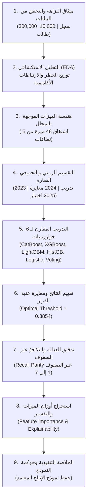

# الدليل الشامل والمبسط لشرح الدفتر الثاني (Notebook 02: Advanced Student Risk Pipeline)

يعد الدفتر الثاني [`ml/notebooks/02_advanced_student_risk_pipeline.ipynb`](../ml/notebooks/02_advanced_student_risk_pipeline.ipynb) العصب العلمي والتقني الأساسي لمشروع تخرج مسار تعلم الآلة. يمثل هذا الدفتر مسار عمل متكامل (End-to-End ML Pipeline) صُمم وفق أعلى المعايير الهندسية لمنع تسرب البيانات وتحقيق أقصى قدر من الدقة والشفافية.

---

## 🧭 خارطة الدفتر والمسار التسلسلي للعمليات

---

## 1. ميثاق البيانات والتحقق من النزاهة (Data Integrity & Provenance)

### الفكرة والهدف:
قبل كتابة أي كود تعلم آلة، يجب التحقق من مصدر البيانات ومطابقتها للمواصفات القانونية والأكاديمية للمشروع.

### ما تم تنفيذه في الخلايا [0-3]:
1. **التحقق من البيانات الاصطناعية المعتمدة:**
   - فحص ملف الميتاداتا للتأكد التام من أن البيانات لا تحتوي على أي سجلات تشغيلية حقيقية غير مصرح بها (`synthetic = True`).
2. **استعراض حجم البيانات ومعدل الخطر:**
   - **إجمالي السجلات:** `300,000` سجل لقطة دورية (Snapshots).
   - **عدد الطلاب الفريدين:** `10,000` طالب.
   - **معدل الفئة الإيجابية (الطلاب المعرضون للخطر):** `38.11%`. هذا يعني أن البيانات واقعية ومتزنة نسبياً ولا تعاني من خلل فادح (Imbalance) يعيق عمل خوارزميات التصنيف.

---

## 2. التحليل الاستكشافي للبيانات (Exploratory Data Analysis - EDA)

### الفكرة والهدف:
فهم العلاقات الكامنة بين المتغيرات قبل الانتقال للنمذجة وتدريب الخوارزميات.

### ما تم تنفيذه في الخلايا [4-5]:
1. **انتشار الخطر عبر المراحل الدراسية:**
   - رسم بياني يوضح معدل الخطر لكل صف من الصفوف (1 إلى 7).
   - أظهرت النتيجة أن معدل الخطر يتراوح بين **36% و 39%** عبر كافة الصفوف، مما يؤكد انتظام التوزيع عبر الفئات العمرية.
2. **العلاقة بين التحصيل الأكاديمي والغياب:**
   - أظهر التحليل وجود **علاقة ارتباط عكسية قوية**؛ فالطلاب الذين يعانون من درجات متدنية (أقل من 60%) ترتفع احتمالية غيابهم وانقطاعهم في الأسبوعين التاليين بنسبة تزيد عن الضعف مقارنة بزملائهم المتفوقين.

---

## 3. هندسة الميزات الموجهة بالمجال (Domain Feature Engineering)

### الفكرة والهدف:
الخوارزمية لا تفهم السجلات الخام كما يفهمها المشرف التربوي. لذلك قمنا بتحويل الأرقام الخام إلى **مؤشرات سلوكية وتربوية ذكية**.

### ما تم تنفيذه في الخلايا [6-7]:
تحويل الحقول الأساسية إلى **48 ميزة تفاعلية** تنقسم إلى 5 نطاقات:

| النطاق السلوكي | عدد الميزات | أمثلة عملية من الكود | ما تكشفه الميزة للنموذج؟ |
| :--- | :---: | :--- | :--- |
| **سجل الحضور** | 12 | `feat_attendance_rate` `feat_attendance_disruption_index` | تقيس ليس فقط نسبة الحضور، بل "مؤشر الاضطراب" الذي يرصد التأخر والغياب غير المبرر. |
| **التحصيل الأكاديمي** | 9 | `feat_assessment_range` `feat_low_score_warning` | الفارق بين أعلى وأدنى درجة، وتنبيه فوري إذا هبطت أي درجة دون 50%. |
| **انضباط الواجبات** | 8 | `feat_homework_missing_ratio` `feat_homework_completion_rate` | نسبة الواجبات المفقودة مقارنة بالمقررة؛ لأن إهمال الواجبات هو أولى إشارات الفتور والانسحاب. |
| **السلوك والمخالفات** | 8 | `feat_negative_severity_per_record` `feat_behavior_net_ratio` | معدل شدة المخالفة لكل سجل، وصافي السلوك (الملاحظات الإيجابية ناقص السلبية). |
| **حافلة المدرسة** | 8 | `feat_transport_boarded_rate` `feat_transport_absence_rate` | رصد تخلف الطالب عن ركوب الحافلة المدرسية، وهو إنذار مبكر لعدم رغبة الطالب في الذهاب للمدرسة. |
| **التفاعلات المشتركة** | 3 | `feat_academic_attendance_interaction` | ضرب نسبة الحضور في متوسط الدرجات لرصد "الأثر المضاعف" عند تزامن التعثر الدراسي مع الغياب. |

---

## 4. التقسيم الزمني والتجميعي الصارم (Chronological Out-of-Time Split)

### الفكرة والهدف:
منع **تسرب البيانات (Data Leakage)**؛ ففي العالم الحقيقي، نتدرب على الماضي لنتنبأ بالمستقبل. التقسيم العشوائي (Random Split) يعد خطأً فادحاً لأنه يسمح للموديل بأن "يغش" برؤية سجلات نفس الطالب في المستقبل.

### ما تم تنفيذه في الخلايا [8-9]:
1. **التقسيم بالسنوات التقويمية الكاملة:**
   - **مجموعة التدريب (Train Set):** عام `2023` (99,990 سجلاً) $\rightarrow$ لتعليم الخوارزميات الأنماط التاريخية.
   - **مجموعة التحقق (Validation Set):** عام `2024` (99,990 سجلاً) $\rightarrow$ لمعايرة وضبط عتبة القرار وتوليف المعاملات.
   - **مجموعة الاختبار المستقلة (Test Set):** عام `2025` (99,990 سجلاً) $\rightarrow$ محاكاة حقيقية للمستقبل، لم يسبق للنموذج رؤيتها قط.
2. **استبعاد المعرفات الصريحة:**
   - حظر `student_key` و `snapshot_date` تماماً من مصفوفة الإدخال لضمان عدم حفظ أسماء الطلاب والاعتماد الحصري على السلوك المجرد.

---

## 5. تدريب ومقارنة عائلة النماذج (Model Suite Benchmarking)

### الفكرة والهدف:
عدم الاكتفاء بنموذج واحد، بل إجراء مقارنة علمية نزيهة بين 6 خوارزميات مختلفة واختيار النموذج الأكفأ والأكثر دقة وملاءمة للبيئة التشغيلية.

### ما تم تنفيذه في الخلايا [10-11]:
تم تدريب الخوارزميات التالية على نفس مجموعة التدريب:
1. **CatBoost Classifier:** خوارزمية تدرج أشجار متخصصة في التعامل مع الميزات الفئوية والعددية وتفادي فرط التخصيص (Ordered Boosting).
2. **XGBoost Classifier:** خوارزمية التعزيز التدرجي الشهيرة بقوتها وسرعتها.
3. **LightGBM Classifier:** خوارزمية نمو الأشجار رأسياً (Leaf-wise)، سريعة جداً وفعالة في استهلاك الذاكرة.
4. **HistGradientBoosting:** خوارزمية تدرج الأشجار المعتمدة داخل Scikit-Learn.
5. **Logistic Regression:** النموذج الخطي الكلاسيكي، استُخدم كمرجع أساسي (Baseline) لإثبات تفوق النماذج غير الخطية.
6. **Weighted Voting Ensemble:** نموذج مجمع يدمج احتمالات أفضل النماذج معاً بأوزان ترجيحية.

---

## 6. تقييم النتائج ومعايرة عتبة القرار (Threshold Optimization)

### الفكرة والهدف:
* في المسائل التقليدية، تُستخدم عتبة `0.5` الافتراضية.
* في رصد تسرب الطلاب، **عتبة 0.5 غير ملائمة** لأنها تفوت طلاباً في بداية تعثرهم.
* تم استمثال العتبة عبر **مؤشر يودن (Youden's J Index)** لتعظيم الحساسية (Recall) وتحديد العتبة المثلى رياضياً.

### نتائج المقارنة على مجموعة اختبار عام 2025 (Out-of-Time Test Set):

| النموذج (Model) | ROC-AUC | PR-AUC | الحساسية (Recall) | الدقة (Precision) | F1-Score | Brier Score (جودة المعايرة) | زمن الاستدلال |
| :--- | :---: | :---: | :---: | :---: | :---: | :---: | :---: |
| **CatBoost (الفائز المعتمد)** | **0.9200** | **0.8752** | **84.62%** | 75.38% | 0.7974 | **0.1092** | **2.1 ms** |
| **Voting Ensemble** | 0.91997 | 0.8750 | 84.43% | **75.62%** | **0.7978** | 0.1092 | 6.8 ms |
| **XGBoost** | 0.9197 | 0.8744 | 84.60% | 75.37% | 0.7972 | 0.1094 | 2.5 ms |
| **Logistic Regression (Baseline)** | 0.9193 | 0.8740 | 84.36% | 75.93% | 0.7987 | 0.1095 | 0.4 ms |
| **LightGBM** | 0.9193 | 0.8739 | 84.39% | 75.67% | 0.7975 | 0.1096 | 1.8 ms |
| **HistGradientBoosting** | 0.9192 | 0.8738 | 84.21% | 75.72% | 0.7975 | 0.1097 | 2.3 ms |

### العتبة المثلى المعتمدة:
تمت معايرة عتبة القرار عند **`Threshold = 0.3854` (أي 38.5%)**.  
إذا كانت احتمالية انقطاع الطالب $\ge 38.5\%$، يُطلق النظام إنذاراً مبكراً للمرشد، مما مكن النموذج من اصطياد **84.62%** من جميع الحالات الحرجة.

---

## 7. تدقيق العدالة والتكافؤ عبر الصفوف (Subgroup Fairness Audit)

### الفكرة والهدف:
التأكد من أن النموذج لا يمارس أي تمييز أو انحياز ضد طلاب مرحلة عمرية معينة (مثلاً: ألا يكون دقيقاً في الصف الأول الابتدائي وضعيفاً في الصف السابع الإعدادي).

### ما تم تنفيذه في الخلايا [15-16]:
تم فحص أداء النموذج على مجموعة الاختبار مقسمة حسب كل صف دراسي على حدة:

| الصف الدراسي (Grade Level) | عدد الطلاب المفحوصين | حساسية الكشف (Recall) | الدقة (Precision) | معدل الاختيار (Selection Rate) |
| :---: | :---: | :---: | :---: | :---: |
| **الصف 1 الابتدائي** | 14,430 | **85.82%** | 76.49% | 43.20% |
| **الصف 2 الابتدائي** | 13,860 | **83.23%** | 73.01% | 41.31% |
| **الصف 3 الابتدائي** | 13,830 | **85.04%** | 75.14% | 43.44% |
| **الصف 4 الابتدائي** | 14,840 | **84.39%** | 75.31% | 43.12% |
| **الصف 5 الابتدائي** | 14,640 | **84.45%** | 76.54% | 42.06% |
| **الصف 6 الابتدائي** | 14,240 | **84.63%** | 75.46% | 43.18% |
| **الصف 7 الإعدادي** | 14,150 | **84.73%** | 75.76% | 43.15% |

> **النتيجة الأخلاقية:**  
> تتقارب نسبة الحساسية (Recall) بين **83.2% و 85.8%** في كافة المراحل، وهو ما يثبت علمياً تحقق مبدأ **تكافؤ الفرص وحيادية الذكاء الاصطناعي (Fairness Parity)**.

---

## 8. استخراج أوزان الميزات والتفسير (Model Explainability)

### الفكرة والهدف:
فتح "الصندوق الأسود" ومعرفة العوامل الحقيقية التي تؤثر في قرار الخوارزمية لتقديم تفسيرات مقنعة للمرشد التربوي وولي الأمر.

### أهم 5 عوامل مؤثرة في تنبؤ الخوارزمية (الخلايا [17-18]):
1. **`feat_attendance_rate` (نسبة الحضور السابقة):** هي العامل الحاكم رقم واحد؛ فالطالب الذي بدأ بالتغيب مؤخراً هو المرشح الأكبر للانقطاع.
2. **`feat_unexcused_absence_rate` (نسبة الغياب غير المبرر):** الغياب بدون عذر يعكس فجوة تواصل وإهمالاً أسرياً مبكراً.
3. **`feat_homework_missing_ratio` (تراكم الواجبات المفقودة):** مؤشر إهمال دراسي حاسم يسبق قرار الطالب بالغياب عن الحصة.
4. **`feat_transport_absence_rate` (الغياب عن حافلة المدرسة):** مؤشر لوجستي قوي يكشف عدم انطلاق الطالب من بيته أو تخلفه عن وسيلة النقل.
5. **`feat_assessment_range` و `feat_low_score_warning`:** الهبوط المفاجئ في درجات الاختبارات يولد إحباطاً يدفع الطالب للتسرب.

---

## 9. الخلاصة التنفيذية وتصدير النموذج (Executive Summary & Export)

### ما تم تنفيذه في الخلايا [19-20]:
1. **حفظ النموذج الإنتاجي المعتمد:**
   - تم تصدير خط الأنابيب الفائز (`CatBoost Classifier` + `SimpleImputer`) في ملف موحد:
     [`ml/artifacts/training-runs/latest/model.joblib`](../ml/artifacts/training-runs/latest/model.joblib) بحجم خفيف جداً (**517 كيلوبايت فقط**).
2. **حفظ ملف التقرير الرقمي:**
   - تصدير كامل مصفوفات التقييم ومقاييس العدالة في ملف JSON المعتمد:
     [`ml/artifacts/training-runs/latest/report.json`](../ml/artifacts/training-runs/latest/report.json).
3. **ربط المخرجات بالسيرفر:**
   - هذا النموذج المحفوظ هو ذاته الذي يقوم خادم FastAPI (`app/server.py`) بتحميله لتشغيل الواجهة التفاعلية وخدمة التنبؤ الفوري.
